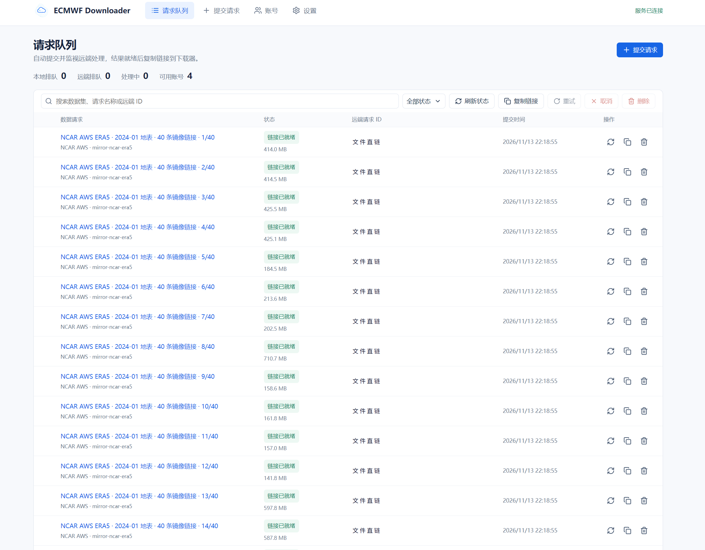

# ECMWF Downloader

**提交 ECMWF 数据请求、查看远端处理状态并取回结果链接。支持 Windows 本地运行和 Linux 服务器部署。**

[](https://github.com/Li-Lazenca-Qiuqi/ecmwf-downloader/tree/v1.0.0)


[快速开始](#快速开始) · [服务器部署](#服务器部署) · [CLI 示例](#cli-示例) · [更新日志](CHANGELOG.md) · [反馈问题](https://github.com/Li-Lazenca-Qiuqi/ecmwf-downloader/issues)

ECMWF Downloader 是一个单用户请求管理工具。你可以在 Web 管理台选择 CDS 数据集和参数，提交后由后台跟踪远端作业。链接就绪后，可逐条或整批复制，再交给自己的下载器传输文件。



## 主要功能

- **浏览数据来源** · 搜索官方 CDS 数据集，按在线字段、变量分类和地图范围填写参数。也可浏览 NCAR AWS ERA5 与 NCAR GDEX ERA5 的已发布文件，直接获取原文件链接。
- **编排请求** · 保存和复用参数预设，可选用 AI 补全。CDS 请求支持按年、月、日或目标份数拆分，手动估算时显示最大子请求及其上限。
- **管理队列** · 查看批次、远端状态和源站提供的文件大小。重启后，已保存远端 ID 的请求会继续查询原作业。按住 Ctrl 点击行内复制图标，可复制同一批次的就绪链接。
- **管理账号和网络** · 查看 CDS 账号的可用或繁忙状态，批量测试连接。在设置中为 CDS、NCAR 和 AI 配置共用网络代理。

## 快速开始

支持 Windows 原生和 Linux（含 WSL）。准备 Git 和 `uv`，项目使用 Python 3.11 或更新版本。仓库已包含构建好的管理台，日常使用无需安装 Node.js。[uv 安装指南](https://docs.astral.sh/uv/getting-started/installation/)

在 PowerShell 或 Bash 中克隆仓库并启动服务。

```bash
git clone https://github.com/Li-Lazenca-Qiuqi/ecmwf-downloader.git
cd ecmwf-downloader
uv run --locked ecmwf web
```

首次运行会安装依赖并创建默认配置和 SQLite 数据库。打开 [本地管理台](http://127.0.0.1:8000)，在「账号」页添加 CDS API Key，即可选择数据集并提交请求。NCAR 原文件链接无需 CDS 账号。[获取 CDS API Key 与使用说明](https://cds.climate.copernicus.eu/api-how-to)

## 服务器部署

服务端只监听 `127.0.0.1:8000`，管理台和 API 共用这个端口。在服务器启动后台服务，再从自己的电脑通过 SSH 转发访问。以下命令以 Linux 服务器为例。

### 1. 在服务器安装

用实际运行服务的普通用户登录服务器。装好 Git 和 `uv` 后，在其家目录安装项目依赖。

```bash
cd ~
git clone https://github.com/Li-Lazenca-Qiuqi/ecmwf-downloader.git
cd ecmwf-downloader
uv sync --locked
```

### 2. 在服务器后台启动

有管理员权限且服务器使用 systemd 时，可将以下内容保存为 `/etc/systemd/system/ecmwf-downloader.service`。将 `your-user` 和项目路径替换为实际用户和克隆路径。工作目录用于定位默认配置和数据库。[systemd 服务配置手册](https://www.freedesktop.org/software/systemd/man/latest/systemd.service.html)

```ini
[Unit]
Description=ECMWF Downloader
After=network.target

[Service]
Type=simple
User=your-user
WorkingDirectory=/home/your-user/ecmwf-downloader
ExecStart=/home/your-user/ecmwf-downloader/.venv/bin/ecmwf web --host 127.0.0.1 --port 8000
Restart=on-failure
RestartSec=5s

[Install]
WantedBy=multi-user.target
```

执行以下命令启用开机启动，并确认服务正在运行。

```bash
sudo systemctl daemon-reload
sudo systemctl enable --now ecmwf-downloader.service
sudo systemctl status ecmwf-downloader.service
```

查看日志用 `sudo journalctl -u ecmwf-downloader.service -f`，停止服务用 `sudo systemctl stop ecmwf-downloader.service`。

<details>
<summary>只有普通账号时，使用 nohup 启动</summary>

在服务器的仓库目录运行以下命令。

```bash
nohup .venv/bin/ecmwf web --host 127.0.0.1 --port 8000 > ecmwf.log 2>&1 < /dev/null &
echo $!
```

记下最后一行输出的进程号，用 `tail -f ecmwf.log` 查看日志。需要停止时，先用 `ps -p 进程号 -o args=` 确认是这个实例，再用 `kill -TERM 进程号` 关闭。这个方式适合 SSH 断开后继续运行，服务器重启后需重新启动。

</details>

在服务器上检查 API 是否已就绪。

```bash
curl --fail http://127.0.0.1:8000/api/v1/health
```

### 3. 从自己的电脑建立 SSH 隧道

将 `your-user@server.example.com` 换成你的 SSH 登录地址，然后在本地 PowerShell 或终端运行。

```bash
ssh -N -o ExitOnForwardFailure=yes -L 127.0.0.1:18000:127.0.0.1:8000 your-user@server.example.com
```

打开 [服务器管理台](http://127.0.0.1:18000)。这里的 `18000` 是自己电脑的端口，`8000` 是服务器上的应用端口。如果本地 `18000` 已被占用，可以换一个本地端口，并按新端口打开浏览器。服务器只需开放 SSH 入口，应用端口留在回环地址。[OpenSSH 端口转发选项](https://man.openbsd.org/ssh#L)

关闭网页或用 Ctrl+C 断开隧道后，只要服务器上的服务仍在运行，就会继续提交和监视已入队的请求。

## CLI 示例

在运行服务的机器上，从同一个仓库目录执行。下面使用仓库随附的 [ERA5 小请求](doc/note/cds_smoke_request.yaml) 演示。预览会显示请求计划，创建会加入队列并由运行中的后台服务提交给 CDS。

```bash
uv run --locked ecmwf request preview --dataset reanalysis-era5-single-levels --request-file doc/note/cds_smoke_request.yaml
uv run --locked ecmwf task create --dataset reanalysis-era5-single-levels --request-file doc/note/cds_smoke_request.yaml
uv run --locked ecmwf task list --json
uv run --locked ecmwf task links --json
```

所有命令见 `uv run --locked ecmwf --help`。服务启动后，可以在同一个地址访问 `/docs` 查看交互式 HTTP API 文档。API 路径以 `/api/v1` 开头。

## 配置与数据

默认路径相对于启动服务时的工作目录。

| 路径 | 用途 |
| --- | --- |
| `config/app.yaml` | 请求监视、网络代理和 AI 服务的非敏感设置 |
| `config/secrets.yaml` | CDS 和 AI 凭据 |
| `data/ecmwf.sqlite3` | 请求记录、结果链接和参数预设 |

网络代理、AI 和监视设置可在管理台修改。CDS 结果链接可能随源站缓存过期。可先在队列中刷新原请求状态，远端结果失效后再决定是否重新提交。

## 开发与反馈

后端使用 Python、Typer、FastAPI 和 SQLite，前端使用 React、TypeScript 和 Vite。安装开发依赖并运行后端测试。

```bash
uv sync --locked --extra dev
uv run --locked --extra dev pytest
```

修改前端后，从仓库根目录执行以下命令重新构建管理台。

```bash
cd frontend
npm ci
npm run build
```

欢迎通过 [GitHub Issues](https://github.com/Li-Lazenca-Qiuqi/ecmwf-downloader/issues) 反馈问题。提交问题时请附上操作系统、应用版本、复现步骤和去除凭据的错误信息。
